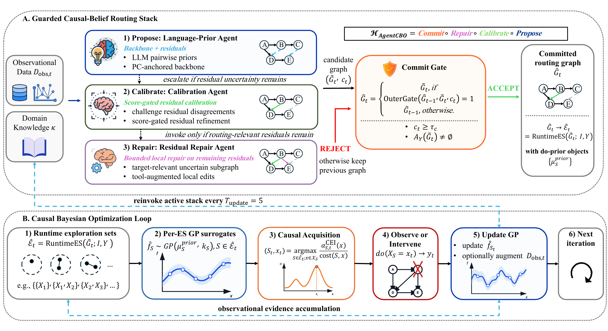

# AgentCBO

Official code for **AgentCBO: Causal Belief Routing for Bayesian Optimization under Unknown Graphs**, accepted at **NeurIPS 2026**.

## Overview

AgentCBO combines an LLM causal prior with PC discovery, guarded graph refinement, and causal Bayesian optimization. The LLM proposes graph information; CBO selects interventions. Causal beliefs guide the intervention sets considered by the optimizer and the do-priors used by its surrogates.

<p align="center">
  
</p>

AgentCBO framework (Figure 2 in the paper). The prior, calibration, and repair agents refine causal graph beliefs under a commit gate. The accepted graph guides exploration sets and do-priors, while CBO selects interventions.

This release focuses on reproducing the core algorithm, its three variants, and the matched PC-only and known-graph controls. External baseline implementations, pretrained model weights, and experiment outputs are not bundled.

## Installation

Use Linux and Python 3.12. Run all commands from the repository root.

```bash
python3.12 -m venv .venv
source .venv/bin/activate
pip install -r requirements.txt
```

## Methods

| Paper method | CLI name | Role |
| --- | --- | --- |
| AgentCBO-Prior | `AgentCBO-LP` | LLM prior with PC discovery |
| AgentCBO-Calib | `AgentCBO-LP-CC` | Prior with guarded calibration |
| AgentCBO-Full | `AgentCBO-LP-CC-RA` | Calib with bounded residual repair |
| PC-then-CBO | `UnknownDAG-CBO` | Matched dynamic PC-only arm in the same guarded pipeline |
| Known-graph CBO | `OracleCBO` | CBO supplied with the ground-truth graph |

Only the first three methods require an LLM service.

## Run AgentCBO

### Hardware and model choice

We use vLLM to serve the language model on an NVIDIA H200 GPU. The vLLM server runs separately from AgentCBO; the PC-only and known-graph controls do not require an LLM or an H200 GPU.

You can download [Qwen-family models](https://huggingface.co/Qwen) or other vLLM-supported open-source models from [Hugging Face](https://huggingface.co/models). Follow the model's license and deployment instructions, choose hardware suited to its size and precision, and configure the vLLM server address and model name below. H200 is our default deployment hardware; other models may use different GPUs.

### Configure vLLM

Start the vLLM server separately, then configure its address and served model name. The main paper experiments use Qwen3.5-35B-A3B at temperature 0.5.

```bash
export USE_VLLM=true
export VLLM_BASE_URL=http://localhost:8000/v1
export VLLM_MODEL=Qwen/Qwen3.5-35B-A3B
```

AgentCBO calls your vLLM server through its OpenAI-compatible API. This describes the interface format, not the model provider: this configuration uses your served model, not an OpenAI-hosted model.

The model name must match the server, and its address must be reachable from the machine running the experiment. Install and run vLLM in a separate serving environment; installing this repository does not start the server. The server must support chat completions with structured JSON-schema responses. To use a cloud API instead, set `USE_VLLM=false`, `OPENAI_API_KEY`, `OPENAI_API_BASE`, and `OPENAI_MODEL`. Prompts are sent to that service; cloud calls may incur charges.

### Compare the three variants

On a workstation or allocated compute node:

```bash
python -m experiments.run_comparison \
  --benchmark ToyGraph \
  --algorithms AgentCBO-LP AgentCBO-LP-CC AgentCBO-LP-CC-RA \
  --n_trials 50 --n_obs_init 100 --n_seeds 20 --temperature 0.5 \
  --output_dir results/toy
```

Append `UnknownDAG-CBO OracleCBO` to `--algorithms` to include both controls. Defaults are 50 outer-loop steps, 100 initial observations, 20 optimization seeds starting at 0, and graph updates every 5 steps. Observation and intervention rounds both count toward the step budget. Use `--start_seed` to select a seed offset and `--debug` to record routing and acquisition traces. Optimization seeds do not make remote LLM responses deterministic; keep the model, serving configuration, and temperature fixed when comparing runs.

### Run with Slurm

For Slurm, use the supplied wrapper instead of running on a login node. Adjust its partition, memory, and time limit for your cluster and benchmark.

```bash
sbatch --export=ALL,PYTHON_BIN=/absolute/path/to/.venv/bin/python \
  scripts/run_comparison.sbatch --benchmark ToyGraph \
  --algorithms AgentCBO-LP AgentCBO-LP-CC AgentCBO-LP-CC-RA \
  --n_seeds 20 \
  --output_dir results/toy
```

The wrapper accepts the same arguments as the Python entry point. For CPU-only controls, replace the algorithm list with `UnknownDAG-CBO OracleCBO`; no model server is needed.

## Benchmarks

| Group | CLI names |
| --- | --- |
| Included main-suite benchmarks | `ToyGraph`, `PSAGraph`, `CompleteGraph`, `CCBOHealth`, `HIVEpidemiology`, `PredatorPrey`, `PISHCATGraph`, `Rosenbrock`, `Ackley`, `Chain-5` |
| Larger-graph benchmarks | `ALARM`, `ER-10`, `ER-20`, `ER-50` |

Use `ER-20-g2`, for example, to select graph-instance seed 2 separately from the optimization seed. Names without the `-g` suffix use graph-instance seed 0. ER graphs use synthetic linear SEMs; the LLM context includes the lower-to-higher index ordering convention.

ALARM uses the published 37-node, 46-arc topology with synthetic continuous SEM parameters. Obtain the model string from [bnlearn](https://github.com/cran/bnlearn/blob/master/man/alarm.Rd), whose package is licensed under GPL-2-or-later. Save only the model string, in the form `[A][B|A][C|A:B]`, to a text file, then configure its path before running ALARM:

```bash
export AGENTCBO_ALARM_MODEL_FILE=/absolute/path/to/alarm-model.txt
```

The topology file is supplied separately; the other benchmarks generate their data without an external dataset download.

## Results

Each successful run saves `<benchmark>_<algorithm>_<seed>.pkl`; completed runs also populate `<benchmark>_summary.csv`. Results include the objective trace, graph updates, seeds, model, and numerical settings. Existing per-seed files are skipped, so use a new output directory when changing settings. The runner reports failed runs with a nonzero exit status.

## Code layout

| Location | Contents |
| --- | --- |
| `agentcbo/engines/` | LLM prior, calibration, residual repair, and PC-only discovery |
| `agentcbo/optimizers/` | Guarded AgentCBO loop and known-graph CBO |
| `agentcbo/causal/` | Graph representation, PC discovery, and exploration sets |
| `agentcbo/models/` and `agentcbo/acquisition/` | Causal surrogates, do-priors, and acquisition functions |
| `agentcbo/benchmarks/` | Benchmark definitions and data generators |
| `experiments/` | Comparison runner |
| `scripts/` and `tests/` | Slurm wrappers and algorithm tests |

## Tests

```bash
pip install -r requirements.txt pytest==9.0.3
sbatch --export=ALL,PYTHON_BIN=/absolute/path/to/.venv/bin/python scripts/test.sbatch
```

Tests cover refinement guards, graph updates, budget accounting, and causal GP scaling, without calling an LLM service.

## Citation

If you use AgentCBO in your research, please cite:

```bibtex
@inproceedings{wei2026agentcbo,
  title     = {{AgentCBO}: Causal Belief Routing for Bayesian Optimization under Unknown Graphs},
  author    = {Wei, Qiyu and Zhang, Xin and Allmendinger, Richard and {\'{A}}lvarez, Mauricio A.},
  booktitle = {Advances in Neural Information Processing Systems},
  year      = {2026}
}
```

## License

Original code is released under the [MIT License](LICENSE).
